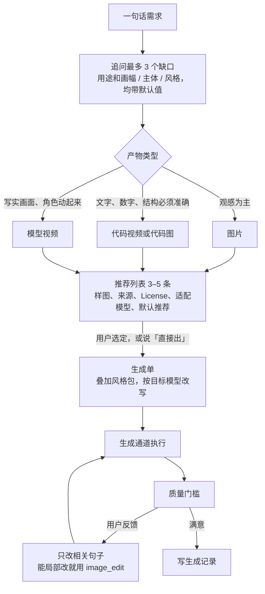

# prompt-studio 设计决策记录

> 状态：accepted（2026-10-27，经 grill-with-docs 会话由用户确认）

## 背景

- 用户只会写一句简单需求，例如「做一张讲 MCP 的公众号封面」，需要有人帮他找到合适的提示词或模板，逐步打磨，再交给能生成的工具。
- 生图、生视频的能力分散在各个宿主和工具里：Codex 与 Grok Build 自带 `image_gen`，Grok 还有 `reference_to_video`；MiniMax、Veo 等走 HTTP API；代码视频由 Hyperframes、Remotion 等引擎渲染。Claude Code 本身没有生成工具。
- GitHub 上已有高质量的提示词库，但没有一个入口能把「找提示词 → 打磨 → 选通道生成 → 验收」串起来：
  - `YouMind-OpenLab/ai-image-prompts-skill`（MIT，1 万多条，按用途分成 JSON，每天同步两次）只负责找提示词和按内容改写，不负责生成。它的 JSON 每条只有 `id`、`content`、`title`、`description`、`sourceMedia`、`needReferenceImages`，没有热度或适配模型字段。
  - `heygen-com/hyperframes`（Apache-2.0）带约 450 个 registry 块、自检命令和「AI 默认审美」禁用清单，是代码视频的首选引擎。
  - 视频模型提示词库里只有 `YouMind-OpenLab/awesome-seedance-2-prompts` 量大且在更新。
- 本 skill 公开发布在 `adonis-skills`，任何人都能装，不能写死某个人的账号、路径或品牌。

## 决策

### 定位

- 做一个公开 skill `prompt-studio`（显示名：提示词工坊），放进新建的 `create`（创作）分组。
- skill 自己不生成任何东西。它的产物是一份**生成单**，交给当前环境里可用的**生成通道**去执行，生成后回来做验收和记录。
- 图片、代码视频、模型视频共用一个入口；视频细节放在按需读取的 `references/` 里，不拆成两个 skill。

### 流程

- 产物类型的判断借用 Grok `imagine` skill 的原则：文字、数字、结构必须准确的（图表、带标签的图解、分镜格子）用代码做；只看观感的（插画、场景、人物）交给生成模型。
- 默认在推荐列表处停下让用户选；用户说「直接出」就用默认推荐。

### 提示词和模板的来源与排序

- 图片：直接按分类读取 YouMind 仓库里的原始 JSON（不需要安装它的 skill）；离线时退回 skill 自带的种子库（`assets/seed-prompts.json`，从 YouMind 每类抽 5 条，按 CC BY 署名）；再不够就在线搜 GitHub。实现时发现 `jamez-bondos`、`JimmyLv` 的 License 是 NOASSERTION，不能打包，所以没用它们做种子。
- 代码视频：Hyperframes registry（`npx hyperframes catalog --query ... --json`），以及用户本机已装的动画 skill。
- 模型视频：Seedance 提示词库，加按模型拆分的写法规则。
- 排序信号（单条热度拿不到，用这四个近似）：
  1. 匹配度：关键词粗筛约 30 条，再由 agent 读标题和描述挑出最贴合的。
  2. 看样图：agent 直接看样图，淘汰崩坏、跑题、水印重的。
  3. 来源档次：README 标 Featured 的、人工精选库的条目加分；仓库 star 只决定收录哪个库，不给单条排序。
  4. 用户打分：用过且高分的条目优先，预览图改用用户自己生成的结果。
- 推荐时一律显示来源和 License，满足 CC BY 的署名要求；没有 License 的条目只作内部参考并标明。

### 生成通道

| 通道             | 能出什么                        | 调用方式                                                         |
| ---------------- | ------------------------------- | ---------------------------------------------------------------- |
| 当前宿主自带工具 | Codex、Grok 出图；Grok 出视频   | 直接调用                                                         |
| 其他 agent CLI   | 同上                            | `codex exec -`、`grok -p`，提示词走 stdin                        |
| HTTP API         | 例如 MiniMax 图片与 Hailuo 视频 | 用户自配 key，skill 只写变量名                                   |
| 代码渲染         | 代码视频、精确的信息图          | Hyperframes 优先；手绘水彩、大字排版、React 项目按场景选其他引擎 |

- 优先级：当前宿主自带工具 > 用户在风格包或命令里指定的通道 > 检测到的其他通道（列出来让用户选）。
- 模型视频无论走哪个通道，生成前都先报预计时长和费用，等用户确认。

### 风格包

- 一个 Markdown 文件，固定五项：色盘、禁用项、角色参考图、画幅预设、校验规则。
- 查找顺序：项目里的 `.agents/style-pack.md` → 环境变量指定的路径 → 都没有就不注入风格。
- 品牌内容（角色、色盘、公众号画幅）只出现在使用方自己的风格包里，不进本 skill。

### 匹配后怎么交付

| 层                  | 适用对象                                          | 做法                                                                 | 确认     |
| ------------------- | ------------------------------------------------- | -------------------------------------------------------------------- | -------- |
| 1. 直接内联         | 提示词、各模型写法规则、需求单模板                | 随 skill 发布在 `references/`                                        | 不用     |
| 2. 按需拉取，不安装 | 提示词数据、Hyperframes 模板块、第三方 skill 正文 | 见下方「更新策略」；只读正文，不执行它带的脚本                       | 见下方   |
| 3. 建议安装         | 要长期复用、带脚本或 CLI 的 skill                 | 列出作者、安装量、安全标签和命令；默认项目级、`-s` 单装；不默认 `-y` | 必须确认 |

- 第一次先读第 2 层的正文把作品做出来，做完再按第 3 层建议安装，方便下次复用。

### 更新策略（第 2 层按风险分级，跟最新）

| 来源              | 风险                  | 更新方式                                                                   |
| ----------------- | --------------------- | -------------------------------------------------------------------------- |
| 提示词数据        | 低：文字和图片链接    | 运行时比对远端 `manifest.json` 的 `updatedAt`，比本地新就自动拉取          |
| 模板块            | 中：代码会进项目      | 每次搜最新目录；写进项目前列出文件清单，确认后写入                         |
| 第三方 skill 正文 | 高：是给 agent 的指令 | 每次读最新版，与用户上次确认过的内容比对；有变化先给变更摘要，确认一次再用 |

- 每个来源最多每 10 分钟检查一次。离线或检查失败时用本地缓存，并告诉用户缓存日期。
- Node 22 的 `fetch` 不读 `HTTPS_PROXY`：检测到代理环境变量或 `fetch` 失败时，脚本改用 `curl` 下载。

### GitHub 访问分三档

| 本机情况                            | 访问方式                                | 能力                                       |
| ----------------------------------- | --------------------------------------- | ------------------------------------------ |
| `gh` 已安装且 `gh auth status` 通过 | `gh api`                                | 全部                                       |
| 有 `GITHUB_TOKEN` 或 `GH_TOKEN`     | `curl` 带 token                         | 全部                                       |
| 都没有                              | 只从 `raw.githubusercontent.com` 取文件 | 检查更新照常；关闭在线搜仓库，只搜本地缓存 |

- 依据：REST API 未登录每小时 60 次、按 IP 计；登录后每小时 5000 次；search 接口限制更严（GitHub 官方文档）。
- 第一次落到第三档时提示一次「装 `gh` 并 `gh auth login` 可开启在线搜索」，之后不再重复。
- 不让用户把 token 贴进对话，也不把 token 写进任何文件。
- 被限流时读 `X-RateLimit-Reset`，恢复前只用缓存，不循环重试。

### 质量门槛

- 图片：一次出 2–4 个变体，agent 看图挑一张；检查跑题、乱码文字和风格包规定的尺寸。
- 代码视频：Hyperframes 必须通过 `lint`、`check`，再看 `snapshot --review` 截帧；分镜命中「AI 默认审美」禁用清单的退回重做。
- 模型视频：生成后用 `ffmpeg` 按秒截帧检查；多段拼接时下一段首帧取上一段真实末帧。

### 生成记录

- 默认写在当前项目的 `.prompt-studio/`：`runs.jsonl` 每次生成一条（提示词 id、模型、产物路径、用户打分），另存最终版生成单。目录可由风格包或环境变量改。

### 模型写法规则的范围

- 第一版只写已核实的：Hailuo / MiniMax H3、Grok `reference_to_video`、Veo（Vertex 正式版）。
- Sora 2 API 已于 2026-09-24 停服，Veo 3.1 的 Gemini API preview 已于 2026-10-22 停服：只保留提示词写法经验，不写接口参数。
- Seedance、Kling 的官方参数页这次没抓到正文：标 `UNVERIFIED`，按通用结构写，不写死参数，之后用 `agent-browser` 补查。

## 术语

**需求单**：
用户一句话需求经追问补全后的结构化描述：用途、画幅、主体、风格、时长等。代码视频的需求单沿用 Hyperframes `spec.md` 的字段，能写数字的地方不写形容词。

**生成单**：
交给生成通道执行的最终指令：选定的提示词（已叠加风格包、已按目标模型改写）、参数和参考图。换哪个通道都能直接用。
_Avoid_：prompt 文件、任务单

**生成通道**：
真正执行生成的工具或服务：宿主自带工具、其他 agent CLI、HTTP API 或代码渲染引擎。本 skill 自己不是通道。
_Avoid_：provider、后端

**风格包**：
使用方提供的一份风格约束：色盘、禁用项、角色参考图、画幅预设、校验规则。没有风格包时不注入任何风格。
_Avoid_：主题、品牌配置

**代码视频**：
由 LLM 写代码、再由渲染引擎逐帧输出的视频，画面中的文字和数据完全可控。

**模型视频**：
由视频生成模型根据提示词和参考图直接生成的视频，写实但不可精确控制，按时长计费。

**推荐列表**：
匹配后展示给用户的 3–5 条候选，每条带样图、来源、License、适配模型，并标出一条默认推荐。

**生成记录**：
每次生成留下的一条记录，包括用户打分；它反过来影响下次推荐的排序。

## 改动范围

- `adonis-skills`：新建 `skills/prompt-studio/`（`SKILL.md`、`references/` 下的 image、code-video、model-video、channels、style-pack、delivery、glossary，`evals/evals.json`），在 `apps/web/content/skill-catalog.yaml` 加条目和 `create` 分组（含 `group-create.webp` 插画），并在 `SKILL_TAGS` 里加 `creative` 标签（现有 7 个标签都不是创作类）。
- `adonis-brand`：新增用户本人的 `projects/wechat/style-pack.md`（色盘、禁用项、Nika 参考图路径、公众号画幅预设和校验规则）。
- `adonis-mp`：`wechat-draft/references/tietu.md` 改为走 `prompt-studio`，通道写明 `codex002`，风格包由 `.agents/style-pack.md` 指向 `adonis-brand`。
- 只改文件，不 commit、不 push。

## 验收

1. 「做一张讲 MCP 的公众号封面」：追问不超过 3 个，推荐列表带样图，成图通过 1800×766 与中间 766px 校验。
2. 「把这张封面做成 15 秒动效」：走 Hyperframes，通过 `check`。
3. 「让 Nika 在封面里走起来，6 秒」：走 Grok `reference_to_video`，生成前报了费用和时长；只跑 1 条。
4. `pnpm skills:validate` 通过；`evals.json` 覆盖该触发和不该触发的情况。

## 放弃的方案

- **直接用 YouMind 的 skill，不新建**：它只覆盖找提示词，不管生成通道、风格、视频和验收。
- **图片、视频拆成两个 skill**：生成交给通道后，两者前三步相同；拆开后「封面加 5 秒动效」这类需求要在两个 skill 间来回跳。
- **自己写爬虫维护提示词库**：YouMind 已每天自动同步，自己维护只会更旧。
- **第三方资源一律锁版本**：用户要求跟最新；改为按风险分级，高风险来源靠变更比对加确认来防篡改。
- **强制要求安装 `gh`**：门槛太高；未登录时只关闭在线搜索，其余照常。

## 影响

- 使用方要获得全部能力，需要装 `gh` 并登录；否则只能搜本地缓存。
- 模型视频会花钱，费用由使用方的通道账号承担；skill 只负责事先报价和确认。
- 各家视频模型变化快，`references/model-video.md` 每条规则都要带核对日期，过期的标 `UNVERIFIED`。
